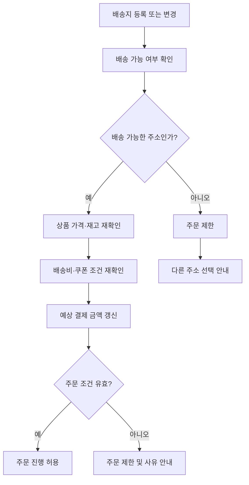
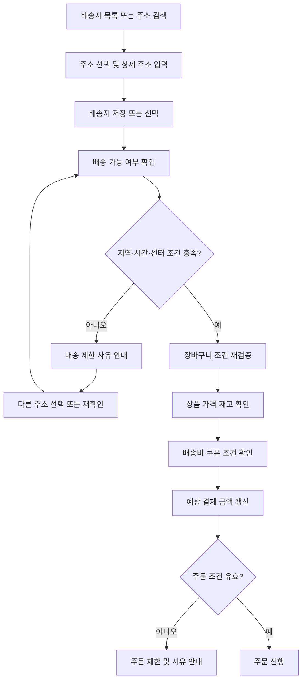

# 2_배송지_서비스이용가능여부

# 1. 배송지 목록 조회 및 선택

**기획 목적:** 고객이 주문 전에 등록된 배송지 중 하나를 선택하거나 새 배송지를 등록하고, 선택한 주소의 배송 가능 여부를 확인한 뒤 주문 화면에 반영하도록 한다.

## 1.1 🗄️ 배송지 목록 데이터

- 🔑 배송지 식별 정보
    - 배송지 ID
    - 고객 계정과의 연결 정보
- 🔑 주소 정보
    - 검색·선택한 주소
    - 상세 주소
- 🔑 배송지 선택 정보
    - 고객이 현재 선택한 배송지
    - 기본 배송지 여부
- 🔑 배송 가능 여부 확인 결과
    - 배송 가능
    - 배송 불가
    - 확인 중 또는 확인 실패

※ 배송지의 실제 저장 구조와 데이터 항목은 제공 자료에서 모두 확정되지 않았다. 위 항목 중 자료에 직접 제시되지 않은 식별·상태 항목은 기능을 설명하기 위한 정리 항목이다.

## 1.2 📱 배송지 목록 화면 진입

1. 장바구니에서 `배달주소` 를 누른다.
2. 고객앱은 등록된 배송지 목록을 조회한다.
3. 등록된 주소와 주소 정보를 표시한다.
4. 고객이 배송지를 선택한다.
5. 선택한 주소를 기준으로 배송 가능 여부 확인을 요청한다.
6. 확인 결과가 반환될 때까지 진행 중 상태를 표시한다.
7. 배송 가능한 주소이면 선택 결과를 주문 화면에 반영한다.

## 1.3 ⚙️ 단계별 비즈니스 로직

| 단계 | 고객 행동 | 고객앱 처리 | 검증·진행 조건 |
| --- | --- | --- | --- |
| 1. 화면 진입 | `배달주소` 선택 | 배송지 목록 화면을 연다. | 주소 설정을 요청했는가. |
| 2. 목록 조회 | 목록 확인 | 등록된 배송지와 주소 정보를 표시한다. | 등록된 배송지가 존재하는가. |
| 3. 주소 선택 | 배송지 선택 | 선택한 주소를 기준으로 다음 처리를 진행한다. | 선택한 주소가 실제로 선택 가능한 상태인가. |
| 4. 배송 가능 여부 확인 | 별도 입력 없이 대기 | 선택 주소를 기준으로 배송 가능 여부 확인을 요청한다. | 배송 가능 지역인지, 해당 주소에 배송할 수 있는지 확인한다. |
| 5. 확인 중 | 결과 대기 | 확인이 끝날 때까지 진행 중임을 표시한다. | 결과 반환 전에 주문 다음 단계로 진행하지 않도록 한다. |
| 6. 결과 반영 | 선택 결과 확인 | 배송 가능하면 주문 화면에 선택 주소를 표시한다. | 주문 화면에 표시된 배송지가 고객이 선택한 주소와 일치하는가. |

## 1.4 ⚠️ 예외 및 화면 처리

| 상황 | 처리 | 고객앱 결과 |
| --- | --- | --- |
| 등록된 배송지가 없음 | 배송지가 없다는 안내와 `새 주소 추가`를 제공한다. >> 확인 필요로 함  | 🔗 주소 등록 화면으로 이동한다. |
| 선택한 주소로 배송 불가 | 배송 불가 안내를 표시한다. `서비스 이용이 불가능한 지역으로 주소를 변경했어요` | 다른 주소를 선택하도록 유도하고 주문 진행을 제한한다. |
| 네트워크 오류 | 오류 안내와 `다시 시도`를 제공한다. | 오류만으로 기존 선택 주소를 임의 변경하지 않는다. |

💬 `[등록된 배송지가 없습니다. 새 주소를 추가해 주세요.]`  >> 미확인 

💬 `[서비스 이용이 불가능한 지역으로 주소를 변경했어요.]` 

💬 `[화면을 불러올 수 없어요. 인터넷 연결 확인 후 다시 시도해주세요.]`

## 1.5 🔗 다른 기능과의 연결

- **인증·계정:** 배송지를 어느 고객 계정에 저장하고 조회할지 결정하는 기반이다.
- **물류·재고·배송:** 선택 주소의 배송 가능 여부를 확인하는 데 필요한 정보다.
- **장바구니·주문·결제:** 배송지 선택 결과가 주문 조건과 예상 결제 금액을 계산하는 기준이 된다.

---

# 2. 배송지 검색 및 지도 확인

**기획 목적:** 고객이 원하는 주소를 검색하고 검색 결과에서 주소를 선택한 뒤, 지도에서 위치를 확인하고 상세 주소를 입력해 배송지를 등록하도록 한다. 위치 정보 접근 권한을 허용하지 않아도 주소를 직접 입력하여 진행할 수 있는 대체 경로를 제공한다.

## 2.1 🗄️ 배송지 등록 입력 데이터

- 🔑 주소 검색어
- 🔑 검색 결과 주소
- 🔑 선택한 주소 정보
- 🔑 지도상 위치 정보
- 🔑 상세 주소
    - 건물번호
    - 동·호수 등 상세 정보
- 🔑 기본 배송지 설정 여부
- 🔑 주소 저장 결과

※ 지도 좌표, 주소 정규화 값 등 내부 저장 항목은 자료에서 확정되지 않았다.

## 2.2 📱 기본 등록 흐름

1. 고객이 주소 검색 화면에 검색어를 입력한다.
2. 고객앱은 주소 검색을 요청하고 검색 결과를 표시한다.
3. 고객이 원하는 주소를 선택한다.
4. 선택한 주소의 위치를 지도에 표시한다.
5. 고객이 지도에서 위치를 확인한다.
6. 고객이 상세 주소, 비밀번호, 찾아오는 길 안내(+ 라이더 요청사항) 등을 입력한다.
7. 카테고리로 우리집 / 회사 / 추가(그외) 로 설정할지 선택한다.
8. 입력한 주소를 확인하고 저장을 요청한다.
9. 저장 결과를 확인하고 저장된 배송지 정보를 보여준다.

| 단계 | 고객 행동 | 고객앱 처리 | 검증·진행 조건 |
| --- | --- | --- | --- |
| 1. 주소 검색 | 검색어 입력 | 검색어를 이용해 주소 검색을 요청한다. | 검색어가 입력되어야 한다. |
| 2. 검색 결과 확인 | 결과 목록 확인 | 검색된 주소 목록을 표시한다. | 선택할 주소가 검색 결과에 존재해야 한다. |
| 3. 주소 선택 | 주소 선택 | 선택한 주소를 기준으로 지도 확인 단계로 이동한다. | 선택한 주소 정보가 있어야 한다. |
| 4. 지도 확인 | 위치 확인 | 선택한 주소의 지도상 위치를 표시한다. | 지도에서 위치를 확인할 수 있어야 한다. |
| 5. 상세 주소 입력 | 건물번호·동·호수 등 입력 | 상세 주소 입력 화면을 표시한다. | 필요한 주소 항목이 입력되어야 한다. |
| 6. 기본 배송지(우리집 / 회사 / 추가(그외)) 설정 | 기본 배송지(우리집 / 회사 / 추가(그외)) 여부 선택 | 배송지 설정 선택을 반영한다. | 배송지 설정 규칙은 별도 확인이 필요하다. |
| 7. 저장 | 저장 요청 | 주소 저장을 요청(`주소 등록`)하고 결과를 표시한다. | 저장이 정상 완료되어야 한다. |

## 2.3 ⚙️ 단계별 비즈니스 로직

## 2.4 ⚠️ 예외 및 대체 경로

| 상황 | 처리 |
| --- | --- |
| 위치 권한 거부 | 위치 권한을 허용하지 않아도 주소를 직접 검색·입력할 수 있도록 한다. 단, `현재 위치로 찾기` 는 예외 사항으로 위치 권한이 필요. |
| 검색 결과 없음 | 검색 결과가 없음을 표시하고 검색어를 수정하도록 안내한다. |
| 지도 로딩 오류 // **확인필요** | 지도 로딩 실패를 안내하고 다시 시도하도록 한다.  |
| 주소 저장 중 통신 오류 | 오류 메시지를 표시하며 입력 내용은 유지한다. |
| 상세 주소 누락 | 필수 항목 누락 시 저장을 제한한다. |

💬 `[검색결과가 없습니다. 주소를 다시 확인해 주세요.]`

💬 `[지도를 불러오지 못했습니다. 잠시 후 다시 시도해 주세요.]`

💬 `[화면을 불러올 수 없어요. 인터넷 연결 확인 후 다시 시도해주세요.]`

## 2.5 ❓ 상세 주소 입력 형식 미결정

자료에서는 동·호수 누락을 필수 입력 오류로 제시하지만, 허용 형식은 두 가지 대안으로 남아 있다.

- **대안 A:** `101동 202호`, `101-202`, `101동202호` 등 다양한 형식을 허용한다.
- **대안 B:** 정해진 형식만 허용하여 오입력을 줄인다.

따라서 동·호수의 필수 여부와 허용 형식은 실제 정책을 확인하기 전까지 확정하지 않는다.

## 2.6 🔗 다른 기능과의 연결

- 주소 검색은 배송지 등록·수정 기능으로 이어진다.
- 저장된 주소는 배송 가능 지역 및 담당 센터 판정의 기준이 된다.
- 배송지 변경 시 장바구니의 배송비·재고·쿠폰 적용 여부를 다시 확인할 수 있다.

---

# 3. 주소 기준 배송 가능 여부 판정

**기획 목적:** 입력하거나 선택한 주소가 배송 가능한 곳인지 확인하고, 배송 가능 여부와 제한 사유를 구분하여 고객에게 안내한다.

## 3.1 ⚙️ 판정에 필요한 조건

자료에서는 주소 자체뿐 아니라 다음 세 가지 조건을 함께 확인하는 예시를 제시한다.

1. **배송 가능 지역:** 주소가 현재 서비스 가능 지역에 포함되는가.
2. **운영 시간:** 해당 지역이 현재 주문 가능한 시간인가.
3. **센터(MFC?) 처리 여력:** 담당 센터가 현재 주문을 처리할 수 있는 상태인가.

자료에는 주소를 기준으로 배송 가능 지역과 담당 센터를 자동 판정하는 예시가 있다. 다만 실제 판정 알고리즘이나 내부 시스템 간 호출 순서는 확인되지 않았다.

## 3.2 🔄 판정 흐름

1. 고객이 배송 주소를 입력하거나 선택한다.
2. 고객앱이 해당 주소의 배송 가능 여부 확인을 진행한다.
3. 주소를 기준으로 배송 가능 지역, 운영 시간, 센터 처리 여력을 확인하는 흐름을 거친다.
4. 판정 결과를 받아 고객앱에 표시한다.
5. 결과에 따라 상품 탐색·주문 진행을 허용하거나 제한한다.
6. 주소가 변경되면 변경된 주소를 기준으로 다시 확인한다.

## 3.3 🗄️ 판정 결과 데이터 예시

| 항목 | 자료의 예시 값 | 설명 |
| --- | --- | --- |
| 주소 ID | `addressA01` | 주소를 구분하기 위한 예시 식별자 |
| 주소 | `예시로 10` | 예시 주소 |
| 배송 가능 지역 | `serviceZone Z1` | 주소가 속한 서비스 지역의 예시 |
| 담당 센터 | `center M1` | 해당 주소를 담당하는 센터의 예시 |
| 지역 버전 | `v3` | 지역 정보 버전의 예시 |

※ 위 ID와 값은 설계 예시다. 실제 B마트의 식별자나 지역 배정 규칙으로 확정된 값이 아니다.

## 3.4 ⚙️ 결과별 처리 규칙

| 결과 | 의미 | 고객앱 처리 |
| --- | --- | --- |
| 서비스 가능 | 선택한 주소로 주문할 수 있다. | 주문 가능 상태를 안내하고 상품 탐색·주문으로 이어지도록 한다. |
| 서비스 지역 외 | 현재 배송 가능한 지역이 아니다. | 별 다른 안내 없이, B마트 어플이 없어지는 것으로 확인됨. |
| 운영 시간 외 | 현재 주문 가능한 운영 시간이 아니다. | 한집배달과 알뜰배달은 불가능하나, 예약 배달 설정이 가능하다는 것을 안내한다. |
| 일시적 처리 지연 | 주문이 많아 현재 처리에 시간이 필요하다. | 잠시 기다린 후 다시 확인하도록 안내한다. |

💬 `[지금 주문하면 오전 7:00부터 배달 가능]`

💬 `[현재 주문이 많아 처리가 지연되고 있습니다. 잠시 후 다시 시도해 주세요.]`  >> 일시 처리 지연 미확인 

## 3.5 ✅ 고객앱 관점의 검증

- 고객이 선택한 주소를 식별할 수 있어야 한다.
- 배송 가능 여부 확인 결과를 받아야 한다.
- 배송 불가, 운영 시간 외, 센터 처리 지연을 서로 다른 상태로 안내해야 한다.
- 주소 변경 후에는 변경된 주소를 기준으로 다시 확인해야 한다.
- 확인 결과가 반환되기 전에는 결과를 임의로 성공 처리하지 않는다.

---

# 4. 배송지 변경 시 장바구니 재검증

**기획 목적:** 고객이 배송지를 변경하면 새 주소에서 기존 장바구니 상품을 주문할 수 있는지 다시 확인한다. 상품과 수량이 같더라도 배송지에 따라 배송비·재고·쿠폰 적용 결과 등이 달라질 수 있다.

## 4.1 🗄️ 재검증 대상 데이터

- 🔑 배송지 ID 및 주소
- 🔑 장바구니 ID
- 🔑 상품 및 선택 수량
- 🔑 상품 금액
- 🔑 배송비
- 🔑 쿠폰 적용 상태 및 할인 금액
- 🔑 예상 결제 금액
- 🔑 배송 가능 여부
- 🔑 지역 정보 버전 등 판정에 사용된 버전 정보

## 4.2 🔄 처리 흐름

1. 고객이 기존 배송지로 상품을 장바구니에 담는다.
2. 장바구니에 상품, 수량, 상품 금액, 배송비, 쿠폰 적용 상태, 예상 결제 금액 등이 표시된다.
3. 고객이 배송지를 변경한다.
4. 고객앱은 변경된 배송지를 기준으로 주문 조건을 재확인한다.
5. 확인 결과에 따라 배송 가능 여부, 상품 가격·재고, 배송비·쿠폰 적용 상태를 갱신한다.
6. 확인된 값으로 예상 결제 금액을 다시 계산한다.
7. 재확인이 끝나고 주문 조건이 유효한 경우 주문하기를 활성화하는 예시가 제시되어 있다.

## 4.3 변경 전후 데이터 예시

| 항목 | 변경 전 | 변경 후 예시 |
| --- | --- | --- |
| 배송지 ID | `addressA01` | `addressA02` |
| 배송지 | 예시로 10 | 테스트로 20 |
| 장바구니 ID | `cartC01` | `cartC01` 유지 |
| 상품 | 삼다수 2L × 2병 | 동일 |
| 상품 금액 | 4,000원 | 4,000원 |
| 배송비 | 2,000원 | 재확인 필요 |
| 쿠폰 적용 | 미적용(0원) | 재확인 필요 |
| 예상 결제 금액 | 6,000원 | 재확인 필요 |
| 지역 버전 | `v3` | `v4` |

※ 금액과 ID는 설계 예시다. 변경 후 배송비·쿠폰·예상 결제 금액은 확정 결과가 아니라 재확인 대상이다.

## 4.4 ⚙️ 항목별 재검증 규칙

| 검증 대상 | 고객앱에서 확인할 결과 |
| --- | --- |
| 배송 가능 여부 | 변경된 주소로 주문할 수 있는지 표시한다.
💬 `[서비스 이용이 불가능한 지역으로 주소를 변경했어요.]`  |
| 상품 재고 | 해당 주소에서 상품을 구매할 수 있는지 재확인한다.
💬 `다 팔렸어요`  등등 |
| 상품 가격 | 변경된 주소에서 상품 가격이 달라지는지 확인한다. |
| 배송비 | 새 주소 기준 배송비를 다시 확인한다. |
| 쿠폰 적용 | 기존 쿠폰이 새 주소와 주문 조건에서도 유효한지 확인한다. |
| 예상 결제 금액 | 확인된 상품 금액·배송비·할인 금액을 기준으로 갱신한다. |
| 주문하기 버튼 | 재확인이 필요한 동안 주문을 제한하고, 완료 후 주문 조건이 유효하면 활성화한다. |

## 4.5 ⚠️ 배송지 변경과 이미 접수된 주문 구분

자료에서는 기본 배송지를 바꾸더라도 이미 접수된 주문의 배송지는 자동으로 변경되지 않는다고 제시한다.

- **기본 배송지 변경:** 앞으로 사용할 기본 주소를 바꾸는 동작이다.
- **장바구니 배송지 변경:** 주문 전 상품의 주문 조건을 다시 확인하는 동작이다.
- **이미 접수된 주문의 배송지 변경:** 별도 절차가 필요한 것으로 제시되어 있으며, 고객센터 문의 예시가 있다.

⚙️ 기본 배송지를 변경했다는 이유만으로 이미 접수된 주문의 배송지를 자동 변경해서는 안 된다.

---

# 5. 배송지 변경 후 주문 가능 여부 재확인

**기획 목적:** 새 배송지에서 기존 장바구니 상품을 구매할 수 있는지 확인하고, 주문할 수 없는 경우 결제를 진행하지 못하도록 한다.

## 5.1 ⚙️ 핵심 시나리오: 새 주소에서 상품 구매 불가

1. 고객은 기존 배송지 `A01`을 사용한다.
2. 장바구니에 삼다수 2L 2병이 담겨 있다.
3. 기존 주소에서는 재고가 있어 주문할 수 있다.
4. 고객이 배송지를 `A02`로 변경한다.
5. 변경된 주소의 가격과 재고를 다시 확인한다.
6. 새 주소에서 상품을 주문할 수 없으면 주문하기를 제한하고 다른 상품을 선택하도록 안내한다.

자료의 예시에서는 변경 전 삼다수 2L 가격이 2,000원이고, 변경 후에는 2,100원으로 표시된다. 변경 후 주소에서는 재고가 없어 결제가 불가능한 사례가 제시되어 있다.

※ 가격 차이와 재고 결과는 예시일 뿐이며, 실제 지역별 가격 정책이나 재고 운영 정책을 뜻하지 않는다.

## 5.2 ⚠️ 주문 제한 상태 처리

| 항목 | 처리 |
| --- | --- |
| 장바구니 상품 | 실제 앱기반, 기존 상품과 수량을 유지 |
| 상품 가격·재고 | 새 주소 기준으로 재확인한다. |
| 구매 불가 상품 | 구매할 수 없음을 명확히 표시한다.
💬 `다 팔렸어요`  등등 |
| 주문하기 버튼 | 주문 불가 상태에서는 비활성화.
ex)구매 불가 상품으로 인한 최소 금액 미충족 등등  |
| 고객의 다음 행동 | 다른 상품을 선택하거나 배송지를 다시 확인하도록 안내한다? |

## 5.3 📍 위치 권한 거부 시 주소 등록

자료에서는 위치 권한을 거부해도 주소 검색을 통해 배송지를 등록할 수 있는 흐름을 제시한다.

1. 위치 권한 요청을 표시한다.
2. 고객이 권한을 허용하지 않으면 직접 주소 검색 경로를 제공한다.
3. 고객이 주소를 검색하고 선택한다.
4. 지도에서 위치를 확인하고 저장한다.
5. 저장한 주소를 기준으로 배송 가능 여부를 확인한다.

⚙️ 위치 권한 거부 자체를 주소 등록 불가 사유로 처리하지 않는다.

## 5.4 ⚠️ 신규 주문 접수 제한

자료에서는 주문이 많은 경우 일시적으로 신규 주문 접수를 제한하는 상황도 제시한다.

- 고객은 상품을 탐색하고 장바구니에 담을 수 있다.
- 고객이 주문하기를 누르면 현재 주문 접수 가능 여부를 확인한다.
- 주문 접수가 제한되어 있으면 주문을 진행하지 못하도록 안내한다.
- 장바구니의 상품과 수량은 그대로 유지하는 예시가 있다.
- 이미 확정된 주문은 신규 주문 접수 제한과 별도로 관리하는 예시가 있다.

💬 `[현재 주문이 많아 신규 주문 접수가 어렵습니다. 잠시 후 다시 시도해 주세요.]`

※ 문구는 기획 예시다. 신규 주문 제한 정책과 재시도 방식은 실제 운영 기준을 확인해야 한다.

!! 해당 부분은 확인을 필요로 한다. !! 

---

# 6. 주소·시간·센터 수용량에 따른 주문 제한 정책

**기획 목적:** 배송 가능 지역, 운영 시간, 센터 처리 여력에 따라 주문이 제한되는 상황을 구분하고, 각 상황에서 고객에게 제공할 대체 행동을 정한다.

> ⚠️ 이 절은 확정된 운영 정책이 아니라 상황별 처리 방안을 검토하기 위한 기획 제안이다.
> 

## 6.1 배송 가능 지역이 아닌 경우

자료에서 제시한 대안은 두 가지다.

| 대안 | 처리 방식 | 고객앱 관점 |
| --- | --- | --- |
| 대안 1 | 배송 가능한 다른 주소를 직접 선택한다. | 다른 주소를 선택하고 배송 가능 여부를 다시 확인하도록 한다. |
| 대안 2 | 해당 지역 서비스가 시작되면 알림을 받도록 신청한다. | 알림 신청 기능의 제공 여부와 조건을 확인해야 한다. |

❓ 서비스 지역 오픈 알림 신청 기능은 실제 제공 여부 확인이 필요하다.

## 6.2 센터 운영 시간이 끝난 경우

자료에서 제시한 대안은 다음과 같다.

- **대안 1:** 주문·결제를 제한하고 장바구니를 유지한다.
- **대안 2:** 예약 기능을 도입하여 가능한 다음 시간대를 제안한다.

❓ 해당 부분은 장바구니 유지 및 예약 기능이 이미 존재하므로 ***해결됨.***

## 6.3 배송지 변경으로 일부 상품을 구매할 수 없는 경우

자료에서는 두 가지 방안을 비교한다.

- **대안 1:** 장바구니 상품을 유지한 채 새 주소에서 구매 가능한지 다시 확인한다.
- **대안 2:** 새 주소에서 구매할 수 없는 상품은 비활성화하고, 고객이 삭제 여부를 선택하게 한다.

❓ 해당 부분은 대안 2번이 B마트에서 채택하고 있는 것으로 확인되므로 ***해결됨.***

## 6.4 고객앱에서 구분해야 하는 상태

| 상태 | 고객에게 안내할 내용 | 확인할 사항 |
| --- | --- | --- |
| 배송 가능 지역 외 | 현재 주소로 배송할 수 없다. | 다른 주소 선택 또는 알림 신청 기능 제공 여부 |
| 운영 시간 외 | 현재는 주문하기 어렵다. | 장바구니 유지 및 예약 기능 제공 여부 |
| 센터 처리 여력 부족 | 현재 주문이 어렵거나 지연되고 있다. | 재시도 방식과 주문 접수 제한 정책 |
| 주소 변경 후 일부 상품 구매 불가 | 새 주소에서는 구매할 수 없는 상품이 있다. | 상품 유지·비활성화·삭제 선택 정책 |

## 6.5 🔗 다른 시스템과의 연결

- **배송·운영:** 서비스 지역, 운영 시간, 센터 처리 가능 여부에 관한 결과가 필요하다.
- **상품·가격·혜택:** 새 주소에서 상품 가격과 쿠폰 조건이 달라질 수 있다.
- **물류·재고:** 주소별 상품 구매 가능 여부를 재확인한다.
- **주문·결제:** 주문 접수 가능 상태가 아닐 때 실제 주문 진행을 제한한다.

자료만으로 각 시스템의 내부 처리 순서나 데이터 전달 방식을 확정할 수는 없다.

---

# 7. 배송지·계정·주문 기능의 연결 관계

## 7.1 배송지 변경이 주문에 미치는 영향

**기본 흐름**

1. 고객이 배송지를 등록하거나 변경한다.
2. 선택한 주소의 배송 가능 여부를 확인한다.
3. 배송 가능한 주소라면 상품 가격·재고·배송비·쿠폰 적용 여부를 재확인한다.
4. 배송 불가라면 주문을 제한하고 다른 주소 또는 상품 선택을 안내한다.
5. 검증 결과를 장바구니와 주문 화면에 반영한다.



※ 위 다이어그램은 자료의 업무 흐름을 이해하기 위한 개념도다. 실제 시스템 호출 순서를 확정하는 다이어그램은 아니다.

## 7.2 기능 간 데이터 전달 관점

| 기능 영역 | 필요한 정보 또는 결과 | 다음 기능에 미치는 영향 |
| --- | --- | --- |
| 인증·계정 | 고객 계정 식별 정보 | 배송지를 어느 계정에 연결해 조회·저장할지 결정하는 기반 |
| 배송지 등록·선택 | 선택 주소 및 주소 식별 정보 | 배송 가능 여부 확인의 입력값 |
| 배송·운영 | 서비스 지역, 운영 시간, 센터 처리 가능 여부 | 주문 가능 또는 제한 상태 결정 |
| 상품·가격·혜택 | 상품 가격, 재고, 쿠폰 적용 가능 여부 | 장바구니와 예상 결제 금액 재계산 |
| 장바구니 | 상품, 수량, 배송지, 재검증 결과 | 주문 진행 전 상태 표시 |
| 주문·결제 | 주문 접수 가능 여부 및 최종 주문 조건 | 조건이 유효한 경우에만 주문·결제 단계로 진행 |
| 고객센터 | 이미 접수된 주문의 배송지 변경 문의 등 | 신규 배송지 선택과 기존 주문 변경을 구분 |

## 7.3 ⚙️ 반드시 구분할 상태

- 기본 배송지 변경과 장바구니 배송지 변경은 같은 동작이 아니다.
- 장바구니 배송지 변경은 주문 전 상품의 조건을 재검증해야 한다.
- 이미 접수된 주문의 배송지는 기본 배송지 변경만으로 자동 변경하지 않는다.
- 배송 불가, 운영 시간 외, 센터 처리 지연은 서로 다른 사유로 구분한다.
- 주소 확인 또는 재검증이 진행 중인 동안에는 주문 진행을 제한하는 흐름을 적용한다.
- 실제 내부 시스템의 담당 범위와 호출 순서는 별도 확인이 필요하다.

---

# 8. ✅ 검증 시나리오

## 8.1 배송지 목록 조회 및 선택

- [ ]  배송지 목록 조회 성공 시 등록된 배송지와 주소 정보가 표시되는지 확인한다.
- [ ]  등록된 배송지가 없으면 빈 상태 안내와 `새 주소 추가` 경로가 제공되는지 확인한다.
- [ ]  고객이 선택한 배송지를 기준으로 배송 가능 여부 확인이 진행되는지 확인한다.
- [ ]  배송 가능 여부 확인이 끝나기 전에 주문 다음 단계로 진행하지 않는지 확인한다.
- [ ]  배송 가능한 주소를 선택하면 주문 화면에 동일한 주소가 반영되는지 확인한다.
- [ ]  배송 불가 주소를 선택하면 주문이 제한되고 다른 주소 선택이 안내되는지 확인한다.
- [ ]  네트워크 오류가 발생해도 기존 주소가 임의로 변경되지 않는지 확인한다.
- [ ]  오류 발생 시 다시 시도할 수 있는 경로가 제공되는지 확인한다.

## 8.2 배송지 검색 및 지도 확인

- [ ]  주소 검색어 입력 후 검색 결과가 정상적으로 표시되는지 확인한다.
- [ ]  검색 결과가 없으면 빈 결과 안내와 검색어 수정 경로가 제공되는지 확인한다.
- [ ]  검색 결과에서 주소를 선택하면 해당 주소가 지도 확인 단계에 반영되는지 확인한다.
- [ ]  지도에서 선택 주소의 위치를 확인할 수 있는지 확인한다.
- [ ]  위치 권한을 거부해도 주소 직접 검색으로 등록을 진행할 수 있는지 확인한다.
- [ ]  상세 주소 필수 항목이 누락되면 저장이 제한되는지 확인한다.
- [ ]  동·호수의 필수 여부 및 허용 형식이 확정된 정책대로 검증되는지 확인한다.
- [ ]  지도 로딩 실패 시 오류 안내와 재시도 경로가 제공되는지 확인한다.
- [ ]  주소 저장 중 통신 오류가 발생하면 입력 내용이 유지되는지 확인한다.
- [ ]  저장 성공 후 저장된 주소 정보가 표시되는지 확인한다.
- [ ]  기본 배송지 설정을 선택한 경우 실제 정책에 맞게 반영되는지 확인한다.

## 8.3 배송 가능 여부 판정

- [ ]  서비스 가능 주소는 주문 가능한 상태로 안내되는지 확인한다.
- [ ]  서비스 지역 외 주소는 배송 불가 사유와 다른 주소 검색 경로가 표시되는지 확인한다.
- [ ]  운영 시간 외 상태가 배송 불가 지역 상태와 구분되는지 확인한다.
- [ ]  센터 처리 지연 상태가 지역 외 상태와 구분되는지 확인한다.
- [ ]  주소 변경 후 변경된 주소 기준으로 배송 가능 여부를 다시 확인하는지 확인한다.
- [ ]  배송 가능 여부 확인 결과가 반환되기 전 성공 상태로 표시하지 않는지 확인한다.
- [ ]  주소 ID, 담당 지역, 센터 등 예시 데이터가 실제 운영 값으로 오인되지 않도록 관리되는지 확인한다.

## 8.4 배송지 변경 후 장바구니 재검증

- [ ]  배송지 변경 후 새 주소 기준으로 배송 가능 여부를 재확인하는지 확인한다.
- [ ]  새 주소 기준으로 상품 재고를 재확인하는지 확인한다.
- [ ]  새 주소 기준으로 상품 가격을 재확인하는지 확인한다.
- [ ]  배송비가 새 주소 기준으로 다시 확인되는지 확인한다.
- [ ]  쿠폰이 새 주소와 주문 조건에서도 유효한지 재확인하는지 확인한다.
- [ ]  검증 결과를 기준으로 예상 결제 금액이 갱신되는지 확인한다.
- [ ]  재검증 중 주문하기 버튼이 제한되는지 확인한다.
- [ ]  주문 조건이 유효하지 않으면 주문하기가 비활성화되고 사유가 안내되는지 확인한다.
- [ ]  새 주소에서 구매 불가 상품이 발생해도 자료에서 제시한 정책에 따라 상품과 수량이 처리되는지 확인한다.
- [ ]  배송지 변경 전후 장바구니 ID와 상품 정보가 의도치 않게 초기화되지 않는지 확인한다.

## 8.5 이미 접수된 주문 및 주문 접수 제한

- [ ]  기본 배송지를 변경해도 이미 접수된 주문의 배송지가 자동 변경되지 않는지 확인한다.
- [ ]  기존 주문의 배송지 변경은 별도 절차로 구분되는지 확인한다.
- [ ]  신규 주문 접수 제한 상태에서 주문하기를 누르면 주문이 제한되는지 확인한다.
- [ ]  신규 주문 접수 제한 상태에서도 장바구니 상품과 수량이 유지되는지 확인한다.
- [ ]  신규 주문 제한과 이미 확정된 주문의 처리가 구분되는지 확인한다.
- [ ]  주문 접수 제한 사유와 재시도 방법이 고객에게 안내되는지 확인한다.

## 8.6 접근성 및 화면 상태

- [ ]  로딩 중임을 고객이 확인할 수 있는 상태 표시가 제공되는지 확인한다.
- [ ]  오류 상태와 배송 불가 상태가 서로 구분되는지 확인한다.
- [ ]  배송 불가·운영 시간 외·센터 처리 지연이 색상뿐 아니라 텍스트로 구분되는지 확인한다.
- [ ]  비활성화된 주문하기 버튼의 상태와 사유를 고객이 이해할 수 있는지 확인한다.
- [ ]  큰 글자 모드에서도 주소, 오류 문구, 주요 버튼이 잘리지 않는지 확인한다.
- [ ]  스크린리더에서 로딩·오류·배송 가능 여부와 버튼 상태를 확인할 수 있는지 검토한다.

---

# 9. ❓ 정책 미결정 및 추가 확인 목록

| 항목 | 현재 자료에서 확인되는 내용 | 추가 결정 또는 확인 사항 |
| --- | --- | --- |
| 대상 지역 | 미정 | 서비스 지역과 지역별 운영 기준 |
| 기본 배송지 설정 | 기본 배송지 선택 단계가 제시됨 | 기본 배송지의 설정·변경 규칙 |
| 상세 주소 입력 | 동·호수 누락 검증 예시가 있음 | 동·호수 필수 여부와 허용 입력 형식 |
| 위치 권한 | 권한 거부 시 주소 직접 입력 가능 | 실제 권한 요청 시점과 화면 흐름 |
| 배송 가능 여부 판정 | 지역·운영 시간·센터 처리 여력을 확인하는 예시 | 실제 판정 담당 시스템과 판정 순서 |
| 지역 오픈 알림 | 대안으로 제시됨 | 알림 신청 기능의 실제 제공 여부 |
| 운영 시간 외 주문 | 주문 제한 또는 예약 기능 대안 | 예약 기능 제공 여부 및 장바구니 유지 정책 |
| 센터 처리 여력 부족 | 일시적 지연·주문 제한 상황이 제시됨 | 제한 기준, 재시도 방식, 안내 정책 |
| 주소 변경 후 구매 불가 상품 | 상품 유지 또는 비활성화·삭제 대안 | 최종 처리 방식 |
| 가격·재고 재검증 | 배송지 변경 후 재확인 필요 | 가격·재고 조회 주체와 갱신 시점 |
| 배송비·쿠폰 | 새 주소 기준 재확인 필요 | 실제 계산·적용 규칙 |
| 기존 주문의 주소 변경 | 기본 배송지 변경으로 자동 변경하지 않음 | 이미 접수된 주문의 변경 가능 조건과 고객센터 절차 |
| 주문 접수 제한 | 신규 주문을 제한하고 장바구니를 유지하는 예시 | 제한 해제 후 재시도 흐름 |
| 내부 데이터 구조 | 일부 예시 ID와 버전이 있음 | 실제 데이터 모델과 시스템 간 인터페이스 |

---

# 10. 전체 흐름 요약



※ 위 흐름은 제공 자료의 내용을 연결한 개념도이며, 실제 시스템의 내부 호출 순서나 구현 구조를 확정하지 않는다.

---

# 11. 추가 정리: 배송지와 배송팀의 연계

배송지는 고객 프로필에만 사용되는 정보가 아니라 상품 탐색, 주문 가능 여부 및 배송 처리에 영향을 주는 데이터이다. 배송지 선택 후 상품을 탐색하는 흐름을 기준으로 고객앱과 배송 담당 영역의 연계를 정의한다.

```
고객
 ↓
배송지 선택
 ↓
상품 탐색
 ↓
주문
 ↓
배송
```

## 11.1 배송지 선택 결과의 전달

- 고객이 배송지를 선택하면 선택한 배송지 식별 정보와 주소 정보를 상품 탐색 및 주문 흐름에 전달한다.
- 배송 가능 여부는 선택한 주소를 기준으로 확인한다.
- 주소 변경 시 변경된 주소를 기준으로 서비스 가능 지역 및 구매 가능 상품을 다시 확인한다.
- 배송지 변경에 따라 재고, 배송비, 쿠폰 적용 및 주문 가능 여부가 달라질 수 있으므로 관련 조건을 재검증한다.

## 11.2 배송팀과의 책임 경계

| 영역 | 담당 내용 |
| --- | --- |
| 고객앱 | 배송지 선택·표시, 확인 중 상태, 결과 및 오류 안내 |
| 배송 가능 지역 판정 | 주소가 서비스 가능 지역에 포함되는지 확인 |
| 물류·센터 | 담당 센터 및 처리 가능 여부 확인 |
| 주문 | 배송지와 주문 조건을 연결하고 신규 주문 접수 가능 여부 확인 |
| 배송 | 접수된 주문의 배송 상태 및 전달 결과 관리 |

실제 시스템 호출 순서와 각 담당 시스템의 데이터 계약은 별도 협의가 필요하다. 배송지 변경은 이미 접수된 주문의 배송 정보를 임의로 변경하는 동작과 구분해야 한다.
